# Crear landings con Rich Text

Usa una web de prueba con el mercado `es` y los idiomas `es` y `en`. Mantén las páginas como borradores. Elige secciones para componer con bloques o Blade para editar los campos de una vista registrada. Usa un título distinto en cada recorrido.

## 1. Landing por secciones desde backoffice

1. Abre **Páginas → Crear página** e indica el título. Deja seleccionado el constructor por secciones. Pulsa **Añadir primera sección** y elige **1:2**. La primera columna presenta el taller y la segunda explica la propuesta.

   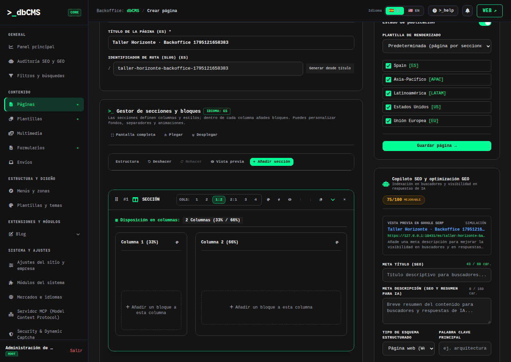

2. En la columna izquierda añade **Título** y escribe «Taller Horizonte». En la derecha añade **Rich Text**. Escribe la descripción en **Visual** y aplícale negrita con el icono de la barra. Abre **Vista previa** para ver la misma frase con el formato aplicado.

   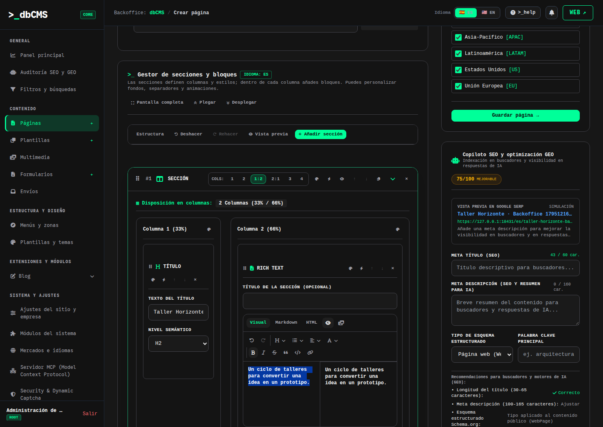

3. Añade otra sección al final. Inserta un **Acordeón** con datos de ejemplo. Adapta las tres preguntas al taller y edita sus respuestas en los Rich Text interiores. El ejemplo usa Markdown para el texto «Objetivo» y su descripción.

   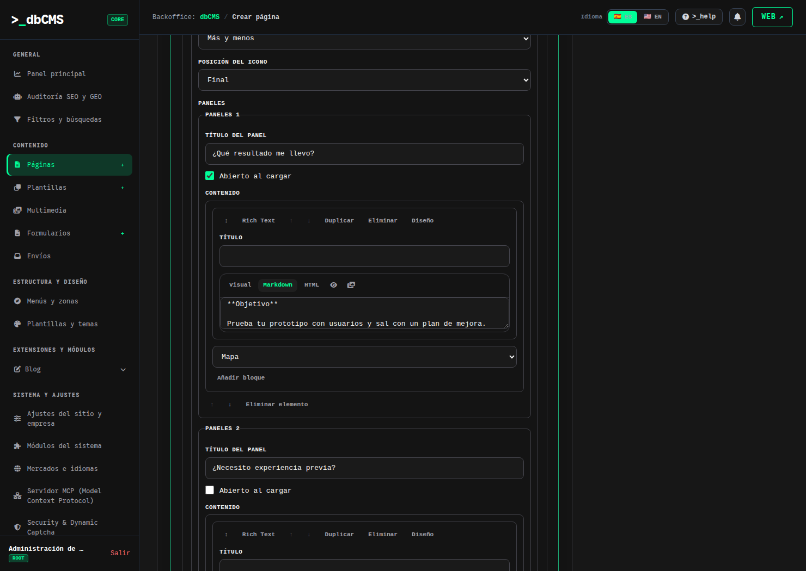

4. En una tercera sección añade **Botón**. Escribe «Consulta las próximas fechas» y usa el destino de contacto de tu sitio. Guarda el borrador, vuelve a abrirlo y pulsa **Vista previa** en la barra del constructor. Comprueba el texto, el acordeón y el destino del botón.

   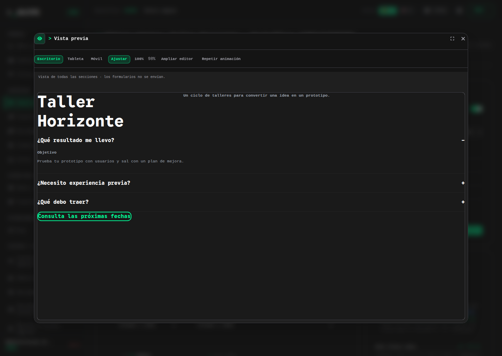

## 2. Landing por secciones desde MCP

1. Ejecuta `cms_block_types` con `entity_type: "page"`, `locale: "es"`, `market: "es"` y `view: "summary"`. Consulta `composition.layouts` y `composition.example`. Para ver el esquema de **Rich Text**, repite la llamada con `view: "detail"` y `block_type: "rich_text"`. Envía `format: "html"` o `format: "markdown"` junto al `content`.

   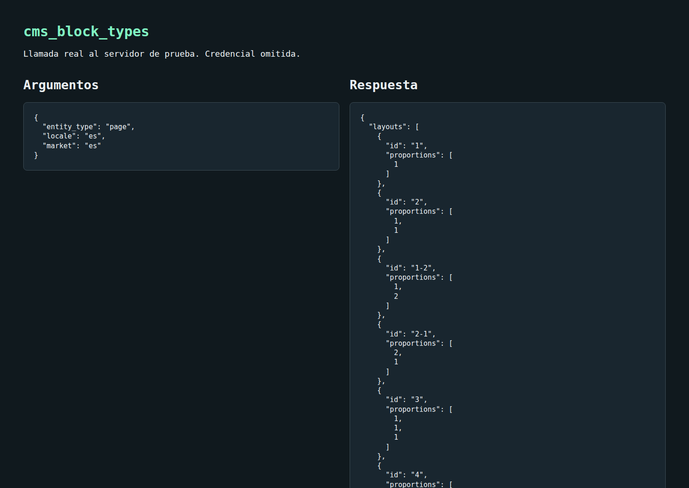

2. Ejecuta `cms_entity_create` con `type: "page"`, el título en `translations.es` y la composición en `sections_json.es`. El borrador del ejemplo contiene una sección 1:2 con título e introducción, una sección de preguntas con un Rich Text dentro del acordeón y una sección con un enlace. La captura muestra el fragmento de la primera sección.

   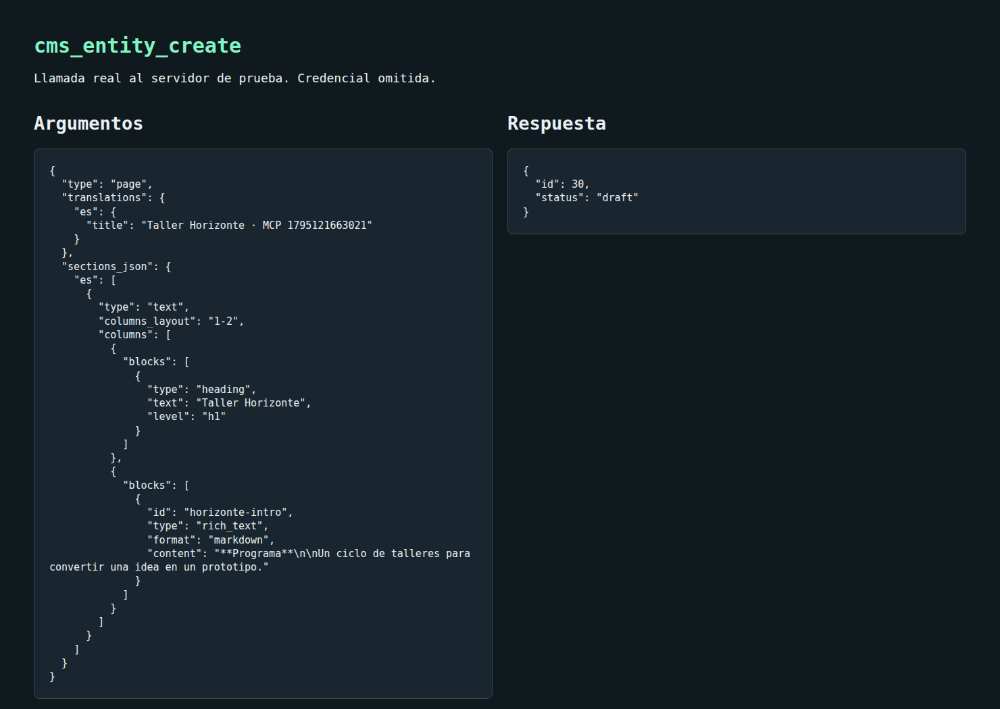

3. Lee el borrador con `cms_content_sections_get` y `view: "summary"`. Busca el ID del bloque en la columna derecha y toma la versión devuelta. Llama a `cms_content_sections_patch` con esa versión, `locale: "es"` y una operación `update` sobre `node_id`. Vuelve a llamar a `cms_content_sections_get` con el mismo `node_id` para comprobar el cambio.

   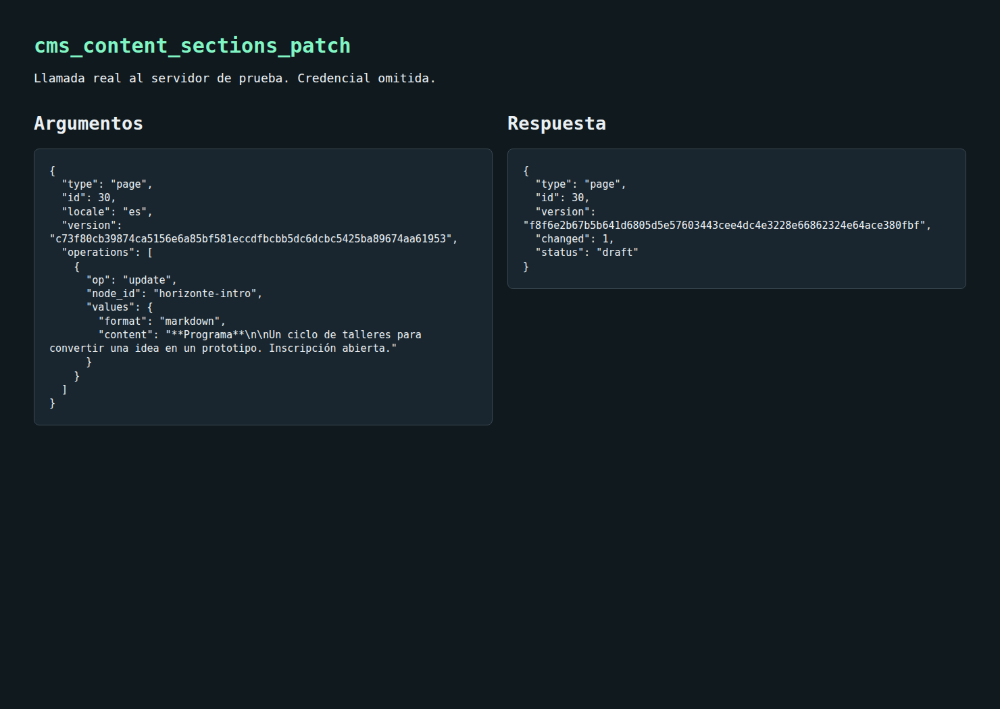

4. Abre el borrador en **Páginas** y usa la vista previa del constructor. Comprueba la frase del parche, el acordeón y el enlace.

   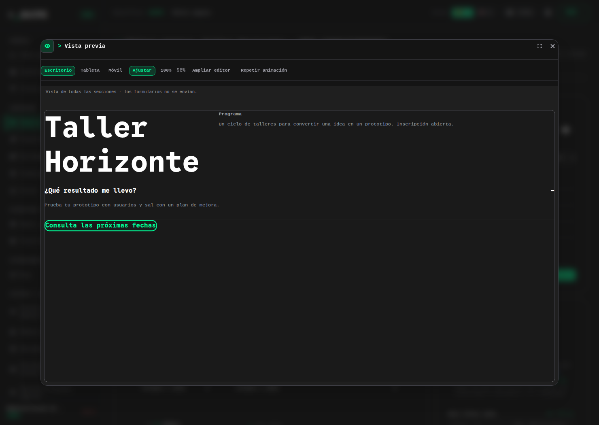

## Preparar la plantilla Blade de los recorridos 3 y 4

En el código de la web, crea `resources/views/pages/editor-qa.blade.php`. La siguiente vista usa los datos de la página y el estilo Rich Text de Core.

```blade
@extends(app(\DbCms\Core\Services\Cms\FrontViewResolver::class)->layout())

@section('content')
    <h1>{{ $templateData['headline'] }}</h1>
    <div class="cms-rich-text">{{ $templateData['body'] }}</div>
@endsection
```

Añade esta entrada al mapa `page_views` de `config/cms.php`.

```php
'editor-qa' => [
    'view' => 'pages.editor-qa',
    'fields' => [
        'headline' => ['label' => 'Titular de la plantilla', 'default' => 'Titular'],
        'body' => ['label' => 'Cuerpo de la plantilla', 'type' => 'rich_text'],
    ],
],
```

El registro declara qué campos son editables. El titular usa un input de una línea. El cuerpo usa Rich Text, saneado al renderizar. En instalaciones con configuración cacheada, refresca la caché del sitio después de registrar la vista. [Contrato de páginas Blade](EXTENSIONS.md#páginas-blade)

## 3. Landing Blade desde backoffice

1. Crea una página, elige `blade:editor-qa` en **Plantilla** y abre **Campos de la plantilla**. Escribe «Taller Horizonte» en **Titular de la plantilla** y añade la descripción en **Cuerpo de la plantilla**. En **Visual**, elige **Centro** y abre **Vista previa**.

   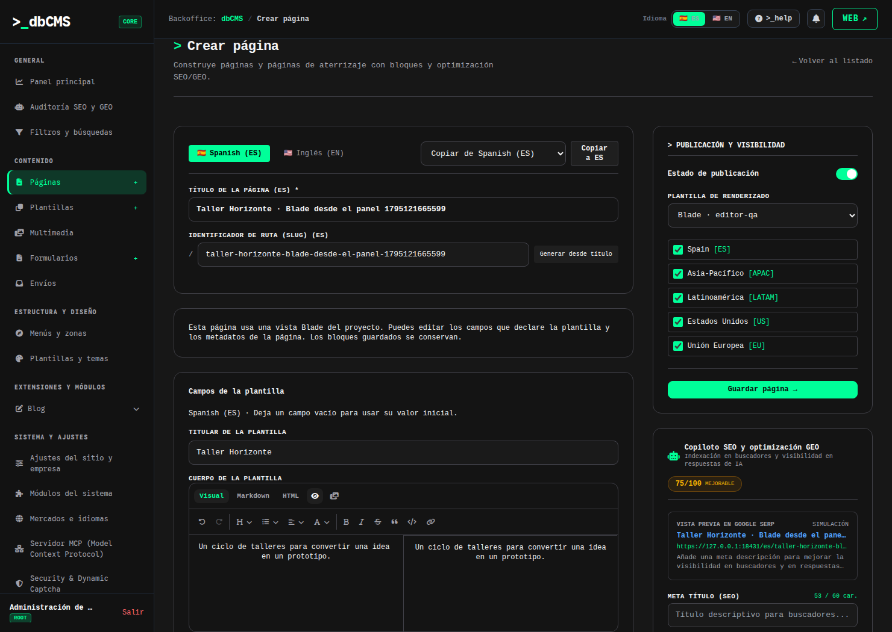

2. Guarda el borrador y vuelve a abrirlo. Comprueba el titular y abre **HTML** en el cuerpo. La fuente contiene el párrafo con su alineación. El formato y el valor corresponden al idioma activo de la página.

   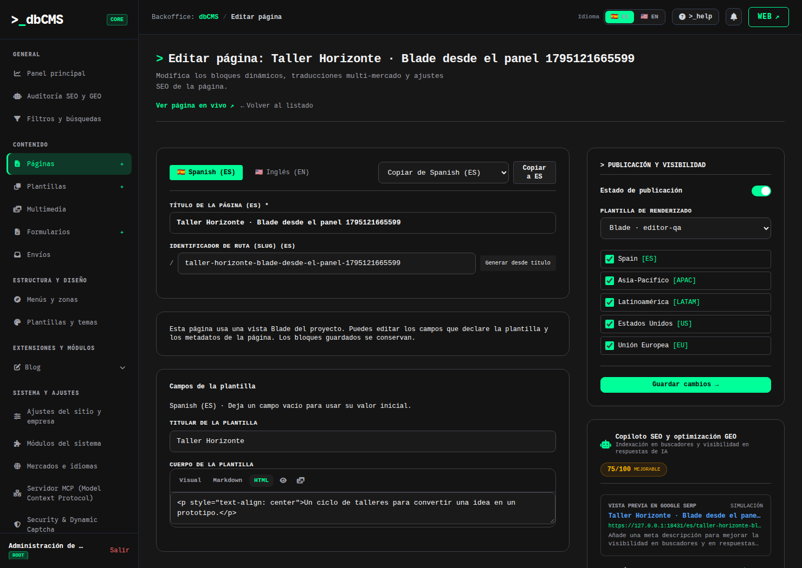

3. Vuelve a **Visual** y abre el control de encabezados. Puedes elegir párrafo o H1–H6 también desde móvil. Al elegir **Encabezado 2**, el párrafo se convierte en un encabezado H2.

   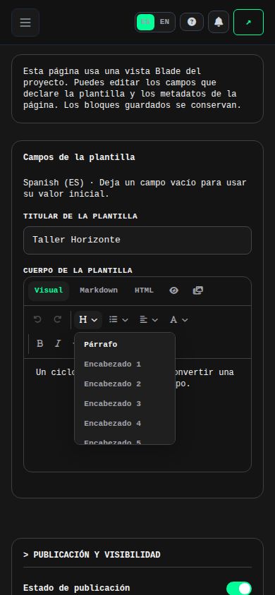

## 4. Landing Blade desde MCP

1. Ejecuta `cms_entity_types` y busca la entrada de tipo `page`. Dentro de su mapa `blade_templates`, abre `blade:editor-qa` y consulta `fields`. El esquema describe `headline` como `text` y `body` como `rich_text` con los formatos disponibles.

   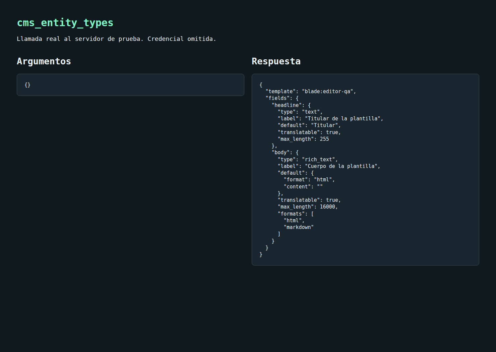

2. Ejecuta `cms_entity_create` con `type: "page"` y `attributes.template: "blade:editor-qa"`. En cada idioma incluye `title` y `template_data`. Envía el titular como cadena y el cuerpo como objeto `{format, content}`. Lee de nuevo con `cms_entity_get` y comprueba los dos idiomas. Para cambiar un campo después, usa `cms_entity_update` sobre la traducción correspondiente. Enviar `null` recupera el valor inicial del campo.

   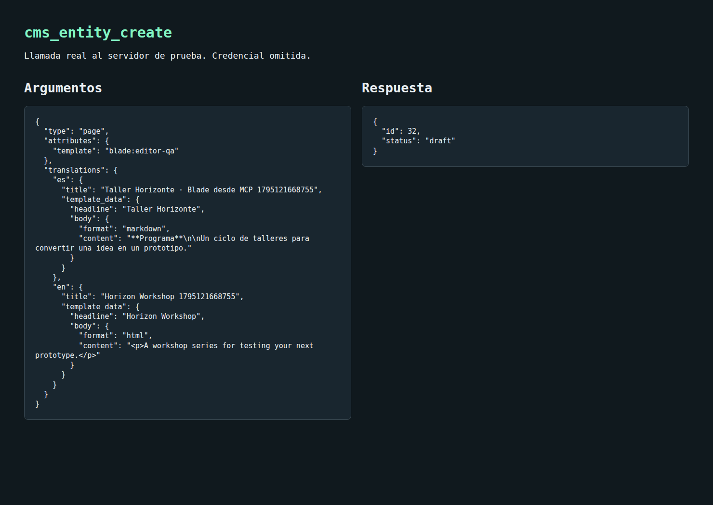

3. Abre el borrador en el panel. Comprueba la vista previa de Markdown en **ES**. Cambia a **EN** y comprueba que el cuerpo se abre en **Visual** con su propia fuente HTML.

   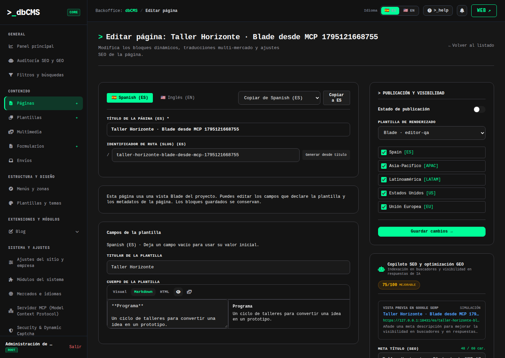

   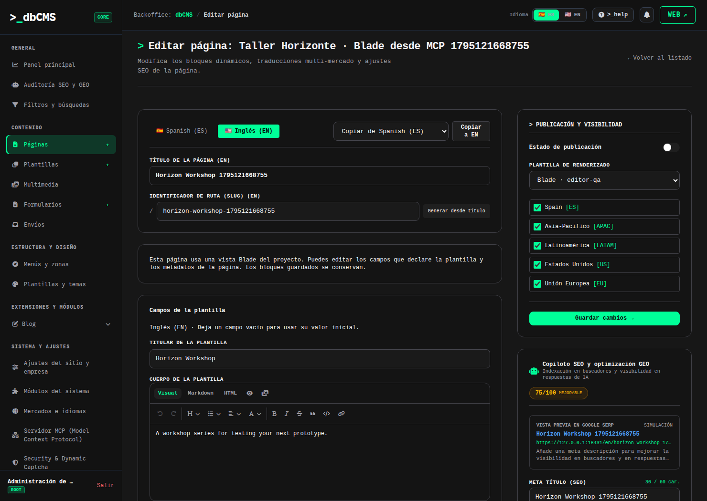

## Repetir las pruebas y las capturas

Usa una instalación desechable con los recursos compilados, el panel en `/admin`, la interfaz en castellano y un mercado activo con código `es` y los idiomas ES y EN. Registra la plantilla anterior. Define `DBCMS_BROWSER_BASE_URL` con la URL de la instalación y `DBCMS_BROWSER_STORAGE_STATE` con el estado de una sesión de Playwright con permiso `manage:pages`. Para los recorridos MCP, define también `DBCMS_BROWSER_MCP_TOKEN` con un token personal con `mcp:access`, `mcp:read`, `mcp:write` y el permiso de páginas de su cuenta. Guarda el estado y el token fuera del repositorio.

Desde el checkout de Core ejecuta `npm ci`. Instala Chromium con `npx playwright install chromium` o define `DBCMS_BROWSER_CHROME` con la ruta al ejecutable de Chrome. Indica un directorio escribible para las capturas con `DBCMS_RICH_TEXT_CAPTURES`, que activa los cuatro recorridos.

```bash
DBCMS_RICH_TEXT_CAPTURES=/tmp/dbcms-rich-text-landings \
    npx playwright test --config tests/Browser/playwright.config.mjs rich-text-landings.spec.mjs
```

Las capturas de MCP muestran argumentos y resultados de la ejecución con la cabecera de autorización omitida. [Pruebas de Core](TESTING.md)
